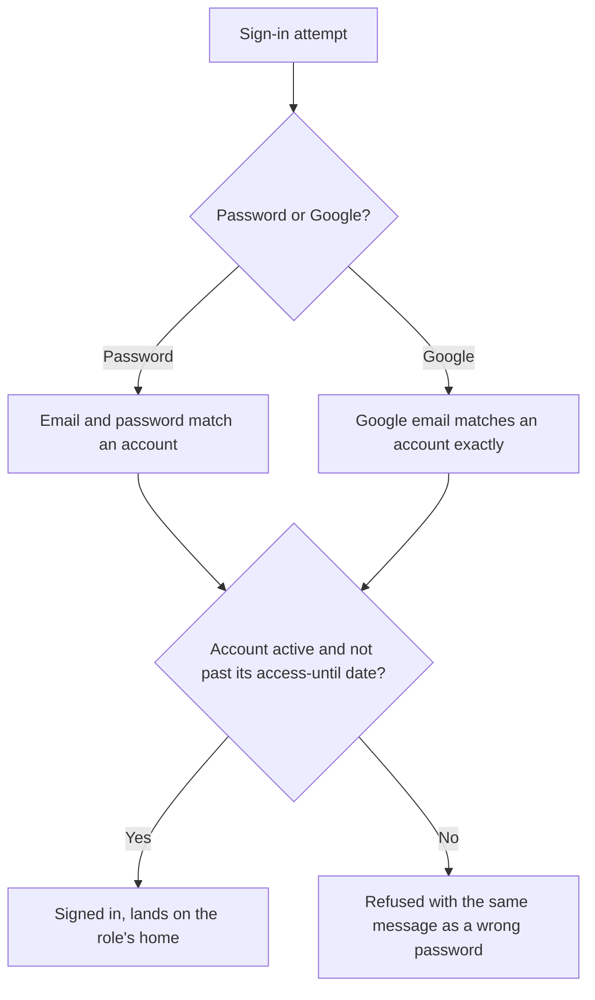
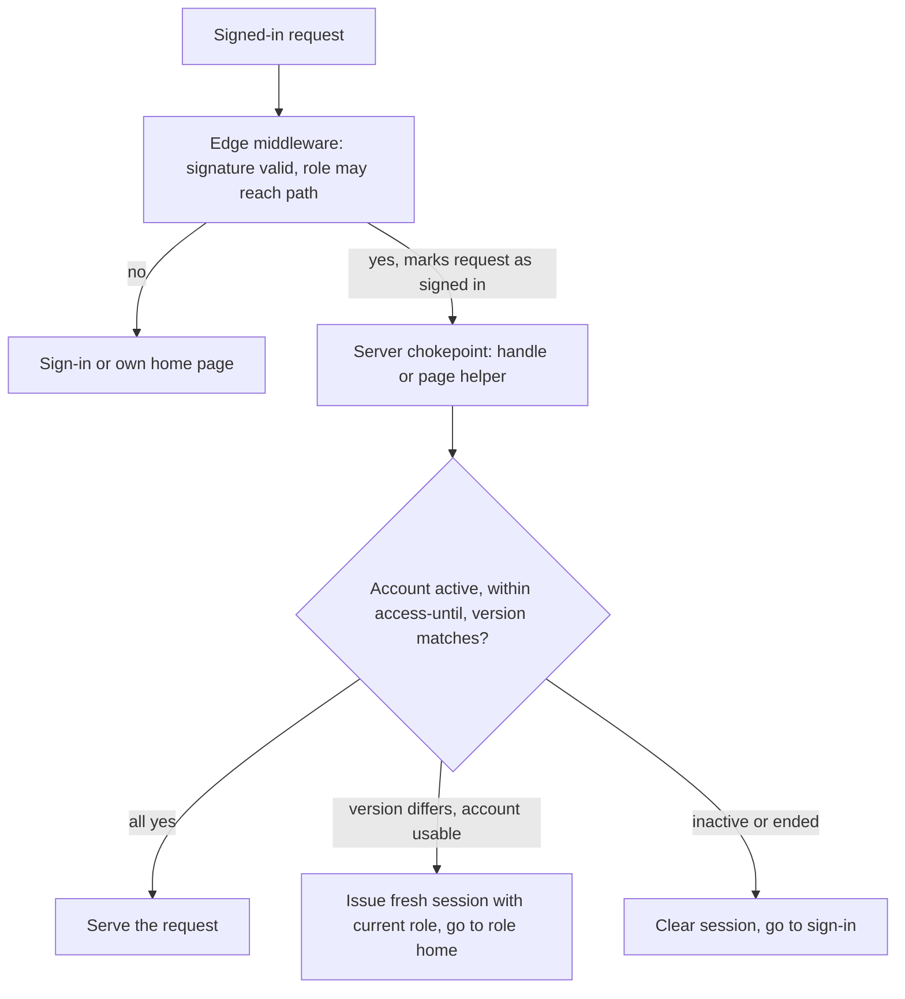
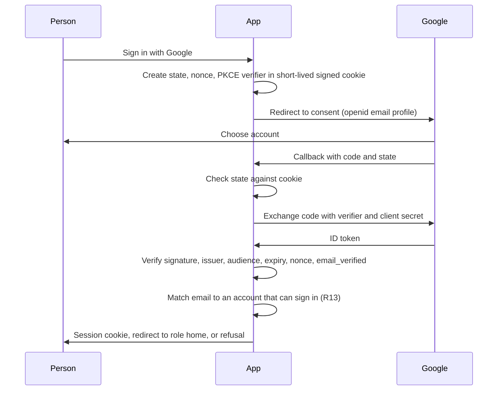
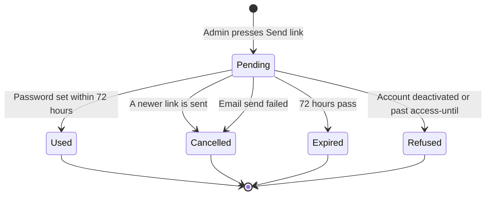
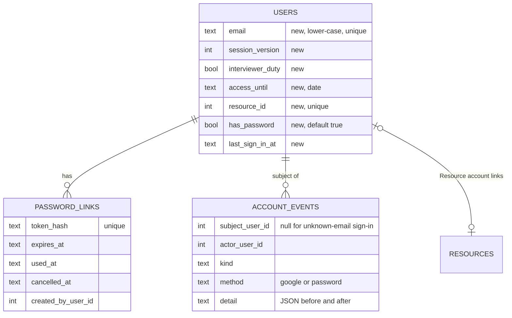

# Accounts and Sign-in - Plan

## Goal Capsule

- **Objective:** Admin can give anyone who needs the platform a working login in minutes. That covers internal staff, about 60 deployed resources and outside interviewers. Each person signs in with their email address, using a password or Google. They lose access on their next click once Admin deactivates them, changes their role, or their access-until date passes. This is the first of three areas in the roles foundation. The other two, new roles and hidden data, are not active scope.
- **Means:** an account check on the server for every signed-in request (KTD1); emailed single-use password links (KTD3); Google sign-in built into the existing sign-in (KTD4).
- **Product authority:** the Product Owner (Techstalwarts). The Product Contract below is authoritative on behaviour, and the Planning Contract on mechanism.
- **Execution profile:** code, Deep. Security-sensitive (authentication, sessions), with an additive database migration and one external integration (Google).
- **Stop conditions:**
  - Stop and ask if a Product Contract requirement cannot be met as written.
  - Stop and ask if Google sign-in cannot accept Gmail addresses under the Workspace's Google Cloud setup.
  - Stop and ask before touching the production database. `npm run db:*` targets production Turso and runs only on the Product Owner's explicit instruction.
- **Who finishes:** the implementing agent builds and verifies on a scratch database copy and merges to `develop`. The Product Owner (or DevOps) authorises the production migration, then the deploy, in that order.

---

## Product Contract

**Product Contract preservation:** changed: added R20–R23. The Product Owner confirmed them at plan scoping on 28 Sep 2026. No existing requirement was altered.

### Summary

A single People screen where Admin creates and manages every login: name, email, role, optional interviewer duty, and, for outside interviewers, an access-until date.
A **Send link** button emails the person a single-use link to set a password. It is the only way a password is set or reset.
People sign in with their email address, either with that password or with **Sign in with Google**.
Deactivation, role changes and expiry take effect on the person's next request.

### Problem Frame

The platform has 11 accounts, created and reset only by an operator running a command-line tool, with the password typed at a prompt.
Accounts have a username but no email address, so the system cannot send anyone anything.
A session is trusted for 12 hours by its signature alone. Disabling an account or changing its role does not affect someone already signed in until that session ends.

Two decisions change the scale and the risk.
Deployed resources will get their own logins to submit timesheets (FSD-00 D1), which adds about 60 accounts.
Outside interviewers will get access to review candidates for their rounds (FSD-00 D5). They are people outside the company whose access must end reliably.
A command-line tool run by one operator cannot onboard 60 people. A 12-hour window where a deactivated outsider can still see candidate profiles is not acceptable.

<!-- ce-section: work-relationships -->
### How This Work Fits Together

This plan covers **Accounts and sign-in** only. The broader roles foundation is currently understood as three areas. This is a working breakdown, not a committed roadmap.

- **Accounts and sign-in** (this plan). How logins are created, delivered, used and ended.
  - **New roles and what they see.** The Accounts, Resource Manager, Interviewer and Resource roles: what each can open and change, their home screens, and Sales seeing deployments with costs hidden.
    - Depends on this plan to invite people into those roles, which R23 makes possible before their access exists.
    - Shares the resource link and the outside-interviewer definition set here (R3, R4).
  - **Hidden data and access requests.** Sensitive fields hidden by default, requests with a reason, and time-limited grants.
    - Depends on both areas above.
    - Shares the account log started here (R19), which it extends to cover grants.

### Actors

- A1. **Admin.** Creates, edits, deactivates and reactivates accounts, sends links, and reads the account log.
- A2. **Internal staff.** People in the existing roles (Admin, Management, TA, Lead Generation, Sales), and later Accounts and Resource Manager. Some also carry interviewer duty.
- A3. **Deployed resource.** A person on a client engagement, with a login tied to their resource record.
- A4. **Outside interviewer.** A person outside the company whose account's main role is Interviewer, with access until a set date.
- A5. **Google Workspace.** The company's email system, used to send links and to confirm Google sign-ins.

### Key Decisions

- **Only Admin sends password links.** Keeps control of every reset. (session-settled: user-directed — chosen over a self-service "Forgot password?" link on the sign-in page: Admin keeps control of every reset.) Governs R7.
- **The email address is the sign-in identifier.** There is nothing extra to remember for about 60 resources and outside interviewers. (session-settled: user-approved — chosen over keeping usernames or accepting either: one identifier, the address links are sent to.) Governs R12, R14.
- **Google sign-in works alongside passwords.** Anyone with a Google account (Gmail or a techstalwarts.com address) needs no password. (session-settled: user-directed — added by the Product Owner over password-only sign-in.) Governs R9, R12, R13.
- **Outside interviewers end on a date.** Nobody has to remember to clean up after a round. (session-settled: user-approved — chosen over manual deactivation and over end dates on every account: access ends automatically where it matters.) Governs R5.
- **One main role, plus interviewer duty for staff.** Staff join panels without a second login. Outsiders get an Interviewer-only account. (session-settled: user-approved — chosen over strictly one role per account and over several roles per account: avoids second logins without combining role rules.) Governs R4.
- **One People screen only.** It is the smallest build. (session-settled: user-directed — chosen over adding a Give login button on resource pages and an account-status / needs-attention view.) Governs R1, R6.
- **Links go out through the company's Google Workspace.** The domain is already set up for mail there. (session-settled: user-approved — chosen over a separate transactional email service: fewer moving parts at this volume.) Governs R18.
- **Account guardrails and visibility.** Admin cannot lock themselves out. A password change ends other sessions. Management sees the People screen read-only. New roles can be assigned before their screens exist. (session-settled: user-approved — confirmed at plan scoping over leaving these unguarded or deferred.) Governs R20, R21, R22, R23.

### Requirements

**Accounts and the People screen**

- R1. Admin creates, edits, deactivates and reactivates every login from one People screen. No other screen creates a login.
- R2. An account records a name, a unique email address, a role, a head flag (for TA, Lead Generation and Sales), interviewer duty (for internal accounts), and an access-until date where R5 requires one. A placeholder address, such as one ending in `@placeholder.local` created when a won requirement was converted, cannot receive links or be used to sign in until Admin corrects it.
- R3. A Resource account is linked to exactly one resource record, and a resource record has at most one login.
- R4. Interviewer duty lets an internal account sit on interview panels using its existing login. An account whose main role is Interviewer is treated as an outside interviewer.
- R5. An outside interviewer's account must carry an access-until date, which Admin can extend or bring forward. The account stops working at the end of that date.
- R6. The People screen lists accounts with name, email, role, and whether the account can currently sign in, and can be searched by name or email.

**Password links**

- R7. **Send link** emails the account's address a link to set a password. It serves first-time invites and resets alike, and it is the only way a password is set or reset.
- R8. A link works once and expires 72 hours after it is sent. Sending a new link cancels any earlier unused link for that account.
- R9. The email offers both ways in: **Sign in with Google**, or set a password through the link.
- R10. A signed-in person can change their own password by entering the current one (FSD-00A G-PLT-03).
- R11. Passwords are at least 10 characters, matching today's rule.

**Signing in**

- R12. People sign in with their email address, either with their password or with **Sign in with Google**.
- R13. Google sign-in succeeds only when the Google account's email exactly matches an account that can currently sign in. There is no self-registration. An unknown, deactivated or ended account is refused.
- R14. An existing account with no email keeps signing in with its username until Admin adds an email. From then on, only the email works for that account.
- R15. A failed sign-in gives the same message whether or not the address has an account.

**Ending access**

- R16. Deactivating an account, changing its role, head flag or interviewer duty, or passing its access-until date takes effect on the person's next request, whichever way they signed in.
- R17. An account that is deactivated or past its access-until date cannot use an outstanding link.

**Email**

- R18. Links are sent from a company address on Google Workspace. If a send fails, Admin sees that it failed. A failure is never reported as sent.

**Account log**

- R19. The log records account creation and edits (before and after values for role, email, head flag, interviewer duty and access-until date), deactivation and reactivation, links sent, passwords set or changed, and every sign-in attempt with its outcome and method (Google or password). Each entry records who acted and when, and Admin can read the log for any account.

**Account safeguards**

- R20. Admin cannot deactivate their own account or remove their own Admin role. The last active Admin account cannot be deactivated or demoted.
- R21. Setting or changing a password signs that account out on every other device. The device where the change was made stays signed in.
- R22. Management can open the People screen read-only. Only Admin can read the account log.
- R23. The Accounts, Resource Manager, Interviewer and Resource roles can be assigned now. Until their access is defined, a person holding one of them who signs in sees only a page saying their access is being set up.

### Key Flows

- F1. Onboarding a new person
  - **Trigger:** Someone needs access: a new resource, a new staff member, or an outside interviewer for a round.
  - **Actors:** A1, and one of A2, A3 or A4, with A5.
  - **Steps:** Admin adds the account on the People screen, choosing a role, linking the resource record for a Resource account, and setting an access-until date for an outside interviewer. Admin then presses Send link. The person receives the email and either signs in with Google or sets a password through the link. They land on their role's home page.
  - **Covered by:** R1, R2, R3, R5, R7, R8, R9, R12, R13, R23
- F2. Resetting a password
  - **Trigger:** A person cannot sign in and contacts Admin.
  - **Actors:** A1 and the person.
  - **Steps:** Admin presses Send link on their account, which cancels any earlier link. The person sets a new password through the new link.
  - **Covered by:** R7, R8, R17, R21
- F3. Access ends
  - **Trigger:** Admin deactivates an account or changes its role, or an outside interviewer's access-until date passes.
  - **Actors:** A1 and the person.
  - **Steps:** On the person's next click they lose access. A deactivated or ended person is refused if they try to sign in again, by either method.
  - **Covered by:** R5, R13, R16, R17
- F4. Moving current users to email sign-in
  - **Trigger:** This feature is released while the 11 existing accounts have usernames only.
  - **Actors:** A1 and A2.
  - **Steps:** Admin adds an email address to each existing account. Each person keeps their password and signs in with the new email, or with Google if that address is a Google account.
  - **Covered by:** R2, R12, R14

### Acceptance Examples

- AE1. **Covers R13.** Given an account registered as `priya@techstalwarts.com`, when someone completes Google sign-in as `priya.personal@gmail.com`, they are refused. No account is created and nothing is linked.
- AE2. **Covers R5, R16.** Given an outside interviewer whose access-until date is 30 Sep, when they click anything on 1 Oct while still signed in from the day before, they are signed out and cannot sign back in.
- AE3. **Covers R8.** Given Admin sent a link on Monday and sends another on Tuesday, when the person opens Monday's link, it is refused as no longer valid, and Tuesday's link works once.
- AE4. **Covers R14.** Given an existing account with username `mamta` and no email, the person signs in with `mamta`. After Admin adds `mamta@techstalwarts.com`, signing in with `mamta` is refused and the email works with the same password.
- AE5. **Covers R2, R3.** Given a resource record whose email ends in `@placeholder.local`, Admin cannot send a link to its Resource account until the email is corrected.
- AE6. **Covers R16.** Given a TA who is signed in, when Admin changes their role to Sales, their next click treats them as Sales. TA-only pages are no longer available to them.
- AE7. **Covers R20.** Given Admin is the only active Admin, when they try to change their own role to Management, the change is refused and the reason is shown.
- AE8. **Covers R21.** Given a person signed in on a laptop and a phone, when they change their password on the laptop, the laptop stays signed in and the phone's next click asks them to sign in.

### Success Criteria

- Admin can create a new resource's account and send its link in under two minutes without the command line.
- No deactivated, changed or ended account keeps its previous access beyond the person's next request.
- Day-to-day account work (onboarding, resets, deactivation) needs no operator at a terminal. The command-line tool remains only as a fallback.

### Scope Boundaries

- **Deferred to the other roles-foundation areas:** what each new role can open and change, and its home screen; Sales seeing deployments with costs hidden; hidden fields and access requests.
- **Decided against for now:** a self-service "Forgot password?" link; a Give login button on resource pages; an account-status or needs-attention view.
- **Not in this plan:** sign-in providers other than Google; two-factor sign-in; locking accounts after repeated failed attempts (FSD-00A G-PLT-12, a good-to-have); end dates on accounts other than outside interviewers.

#### Deferred to Follow-Up Work

- Removing username sign-in for good, once every active account has an email (R14).
- Moving email sending to the Gmail API or Amazon SES if Workspace app passwords are withdrawn (KTD5).

### Dependencies / Assumptions

- Someone with Google Workspace admin rights for techstalwarts.com must set up a sending address for links and a Google sign-in configuration for the application.
- Google sign-in must work on the current production host (Vercel) and on the AWS host after the move, so both addresses need registering with Google.
- The 72-hour link lifetime (R8) is an agreed starting value. It can be tuned later without changing any other behaviour.
- Admin will supply email addresses for the 11 existing accounts (F4).
- The test environment needs a stable hostname before Google sign-in can be tested there. As of 25 Sep 2026, `staffing-test.techstalwarts.com` did not resolve, and the Vercel preview URL is not recorded anywhere. Until one is fixed, U7's check on the test environment is limited to localhost plus production after release.

### Outstanding Questions

**Resolve Before Planning**

- None.

**Deferred to Implementation**

- The final wording of the invite email and the holding page (R9, R23). Keep it plain, and write it through `ce-noslop`.

### Sources / Research

- `lib/schema.ts`: the `users` table has a name, a unique username, a password hash and salt, a role, a head flag, an active flag and an applicant-queue watermark. It has no email column.
- `lib/auth.ts`: signed 12-hour session carrying user id, name and role; PBKDF2 password hashing; legacy shared-password bootstrap.
- `middleware.ts` and `lib/session.ts`: sessions are verified by signature. Only the head flag is re-read from the database on each request.
- `app/api/auth/login/route.ts`: username and password sign-in; uniform failure message with a delay.
- `scripts/user.ts`: the command-line account tool (create, reset, role, head flag, disable and enable), with passwords typed at a prompt and at least 10 characters.
- `app/api/opportunities/[id]/convert/route.ts`: creates resources with a `@placeholder.local` email when a joined candidate has none.
- FSD library, FSD-00 §6–7 and FSD-00A gap register (G-PLT-02, 03, 04, 06, 07): `docs/fsd/`

---

## Planning Contract

### Key Technical Decisions

- KTD1. **The account is re-checked on the server for every signed-in request.** The session token gains a session-version number, and the account row gains the same counter. Every change covered by R16 or R21 increments the counter, except the access-until date passing: the check reads that date directly, so no write is needed when it passes. On each request, server code confirms three things: the account is active, today (in India time) is on or before any access-until date, and the token's version matches. If not, the request is refused before any data is read. The check cannot live in the Edge middleware, because the AWS host keeps the database as a SQLite file that Edge code cannot open. It runs at two server-side chokepoints instead:
  1. `handle()` for API routes. 46 of the 47 non-public routes use it, and the remaining one (the agent configuration check) reads the session directly. Middleware marks each signed-in request with a header it strips from inbound requests.
  2. An explicit helper at the top of every signed-in page, since 13 signed-in pages (the Dashboard and the back-office screens) never read the session today.

  A file-scan test fails if a page or route is added without its chokepoint. (session-settled: user-approved — chosen over short-lived sessions that re-check every few minutes: that is cheaper but is not "next click".) Governs R16, R21.
- KTD2. **When the version changes but the account is still usable, a fresh session is issued rather than signing the person out.** Pages redirect through a refresh route that issues a new token with the current role and sends the person to that role's home. API calls return a "session changed" refusal that the screen answers by reloading. A deactivated or ended account has its cookie cleared and is sent to sign-in. Implements R16 and AE6.
- KTD3. **Password links store only a hash.** The link carries 32 random bytes, and the database keeps the SHA-256 hash, the expiry, and used/cancelled markers. Creating a link cancels earlier unused ones for that account. The email is sent after the link row exists. If sending fails, the link is cancelled and the failure is returned (R18). Governs the mechanism for R7, R8 and R17.
- KTD4. **Google sign-in is a direct OpenID Connect authorization-code flow using `jose`, with no auth library.** The app already owns its sessions, cookies and access table. A library such as Auth.js would replace the session layer to add one provider. The flow uses:
  - `state`, `nonce` and PKCE, held in a signed cookie that lasts 10 minutes
  - ID-token verification against the keys at the `jwks_uri` in Google's discovery document (`https://accounts.google.com/.well-known/openid-configuration`). The issuer must be `https://accounts.google.com` or `accounts.google.com`, the audience must equal the client ID, and the token must be unexpired. The nonce and `email_verified` are also checked: Google requires the first two, and this app adds the last two so an unverified email can never match an account
  - a case-insensitive exact email match against an account (R13)

  (session-settled: user-approved — chosen over adopting a third-party auth library: the app already has its own session handling.)
- KTD5. **Email goes out through a dedicated Workspace mailbox over SMTP, using `nodemailer` and an app password.** The mailbox is something like `no-reply@techstalwarts.com`, with 2-step verification switched on. The sending code sits behind a small interface, so moving to the Gmail API or Amazon SES later touches only that module. (session-settled: user-approved — chosen over a service-account Gmail API or a separate transactional provider: simplest setup at this volume.) Governs the mechanism for R18.
- KTD6. **The new account data is added, never altered in place.** The `users` table gains:
  - email (stored lower-case, unique)
  - session version
  - interviewer duty
  - access-until date
  - resource link (unique)
  - a has-password flag, defaulting to true so existing rows keep working
  - last sign-in time

  New accounts set their username to their email to satisfy the existing unique, not-null username. Accounts invited without a password store an unusable random hash, with has-password false. Two new tables hold password links and account events. This follows the repo's additive-only migration rule (`scripts/migrate.ts` `COLUMN_MIGRATIONS`, `lib/ddl.ts`).
- KTD7. **The four new roles join the role list with no access beyond a holding page (R23).** The access table sends them to `/welcome` only. They get no navigation, cannot write anything, and land on `/welcome`. The commercial-figure strip functions in `lib/access.ts` are left untouched, because these roles reach no data yet and the separate access-gap task is changing those functions.
- KTD8. **The pure rules live in `lib/accounts/` and are unit-tested with Vitest,** which this plan introduces as the repo's first test runner. The rules covered are sign-in eligibility, link validity, Google claim checks, email normalisation and placeholder detection, and the Admin guardrails of R20. Flows and screens are verified on a scratch database copy in the browser, as for earlier modules.
- KTD9. **The command-line tool changes too.** It gains a way to set an account's email. Its disable, role and head-flag commands now increment the session version, so a change made from the terminal also takes effect on the next request.

### High-Level Technical Design

Every signed-in request is checked on the server before data is read (KTD1, KTD2):

Google sign-in (KTD4):

Password-link lifecycle (KTD3):

New and changed data (KTD6):

### System-Wide Impact

- **Every signed-in request pays one indexed account lookup** (KTD1), cached for the life of each request. At tens of users this cost is negligible.
- **Every signed-in page file changes by one line** (13 that read no session today plus the 8 that do, and the new `/welcome` and `/people`). The file-scan test keeps future pages honest.
- **Middleware gains new public routes:** the Google start and callback routes, and the set-password page and its API.
- **New environment variables:** `GOOGLE_CLIENT_ID`, `GOOGLE_CLIENT_SECRET`, `APP_BASE_URL`, `MAIL_USER`, `MAIL_APP_PASSWORD`, `MAIL_FROM`. They must be set on Vercel production and the test environment, and later in the AWS server's environment file.
- **Existing sessions survive the release.** Tokens issued before the release carry no version, and they are read as version 0, which matches every account's starting value.

### Risks & Dependencies

| Risk | Mitigation |
|---|---|
| The Google sign-in consent screen is set to "Internal", which allows Workspace users only, so resources on Gmail and outside interviewers are refused | Configure the consent screen as "External". Only the basic scopes (`openid email profile`) are requested, so Google's app verification is not needed. This is a stop condition in the Goal Capsule. |
| Vercel preview URLs change on every deploy, and Google accepts only registered redirect addresses | Register the production host, the test host and `http://localhost:3123` for scratch runs. Preview builds hide the Google button when `APP_BASE_URL` is not a registered host. |
| Google withdraws or restricts Workspace app passwords | Sending sits behind one module (KTD5). Switching to the Gmail API or SES is local work. |
| The separate access-gap task edits `lib/access.ts` at the same time | Land that task on `develop` first, or rebase this work onto it. KTD7 keeps this plan off its strip functions. |
| A page or route is added later without the chokepoint, which silently reopens the 12-hour window | The file-scan test in U3 fails the build. |
| Schema-dependent code reaches `main` before its columns exist in production, the Phase 16 lesson | Migrate first, then deploy. That order is in the Definition of Done. |

---

## Implementation Units

### U1. Test runner

- **Goal:** give the repo a unit-test command for the pure rules in later units.
- **Requirements:** supports verification of R8, R13, R16 and R20 (KTD8).
- **Dependencies:** none.
- **Files:** `package.json` (dev dependency, `test` script), `vitest.config.ts`, `lib/accounts/README.md` (one line on what belongs in the folder).
- **Approach:** a Node environment with the `@/` path alias matching `tsconfig.json`, and no browser environment.
- **Patterns to follow:** the existing `tsx`-based scripts for TypeScript execution.
- **Test scenarios:** Test expectation: none -- scaffolding only. U3 onwards add the first tests.
- **Verification:** the test command runs and reports zero tests without error.

### U2. Account data, roles and the holding page

- **Goal:** add the new account columns and tables, register the four new roles, and give those roles the holding page.
- **Requirements:** R2, R3, R4, R5, R19, R23 (KTD6, KTD7).
- **Dependencies:** U1.
- **Files:** `lib/schema.ts`, `lib/ddl.ts`, `scripts/migrate.ts`, `lib/auth.ts` (roles, labels), `lib/access.ts` (access rules, landing path, navigation), `app/welcome/page.tsx`, `lib/accounts/roles.test.ts`.
- **Approach:**
  1. Add columns through `COLUMN_MIGRATIONS`, with the unique indexes on email and resource link.
  2. Create the password-link and account-event tables in `lib/ddl.ts`, with indexes on account and date.
  3. Add `accounts`, `resource_manager`, `interviewer` and `resource` to both role lists, `ROLES` in `lib/auth.ts` and `USER_ROLES` in `lib/schema.ts`, and to the labels.
  4. In the access table, allow the new roles only `/welcome` and the auth routes, and set their landing page to `/welcome`. `canAccess` and `canWrite` currently treat any role they don't recognise as TA, so the four roles need explicit branches ahead of that fall-through. Without them the new roles would get TA's read and write access.
  5. Build `/welcome`, which states that access is being set up.
- **Patterns to follow:** earlier additive migrations in `scripts/migrate.ts` (for example the paid and unpaid leave columns); `landingPath` and `canAccess` in `lib/access.ts`.
- **Test scenarios:**
  - Each new role's landing path is `/welcome`.
  - Each new role can reach `/welcome` and `/api/auth/logout` and nothing else. `/`, `/pipeline`, `/resources` and `/api/users` are all refused.
  - Each new role is refused writes on every path.
  - The existing five roles' access decisions are unchanged for a sample of paths (characterisation).
- **Verification:** the migration runs twice on a scratch database copy without error and leaves existing rows unchanged, with has-password true and version 0. A new-role account sees only `/welcome`.

### U3. Account check on every signed-in request

- **Goal:** access changes take effect on the next request.
- **Requirements:** R5, R16, R21, AE2, AE6 (KTD1, KTD2, KTD9).
- **Dependencies:** U2.
- **Files:** `lib/accounts/eligibility.ts`, `lib/accounts/eligibility.test.ts`, `lib/auth.ts` (version claim), `lib/session.ts` (per-request cached check, page helper), `lib/api.ts` (`handle()` check), `middleware.ts` (signed-in marker header, stripped from inbound), `app/api/auth/refresh/route.ts`, every signed-in `app/**/page.tsx`, `scripts/user.ts` (version increments), `lib/client.ts` (reload on a "session changed" refusal), `tests/chokepoints.test.ts`.
- **Approach:**
  1. The eligibility rule is a pure function of the account row, the token and the current date in India time.
  2. `getSession` runs it once per request (memoised for that request). `handle()` runs it when the middleware marker is present.
  3. Pages call one helper that redirects through the refresh route or to sign-in, per KTD2.
  4. The refresh route re-issues the token with the current role and version. The shared `api()` helper in `lib/client.ts` answers a "session changed" refusal by reloading the page, so the refresh happens without per-screen code.
  5. The command-line disable, role and head-flag commands increment the version.
  6. The chokepoint test scans every non-public `page.tsx` for the helper and every non-public `route.ts` for `handle()`, and fails the build if one is missing.
- **Patterns to follow:** `getViewer` in `lib/session.ts` already re-reads the head flag each request. The `PUBLIC_PREFIXES` and `PUBLIC_EXACT` lists in `middleware.ts` define what is exempt.
- **Test scenarios:**
  - An active account with a matching version and no access-until date is eligible.
  - An inactive account is not eligible.
  - Covers AE2. An account with access-until 30 Sep is eligible at 23:59 IST on 30 Sep and not eligible at 00:00 IST on 1 Oct.
  - A token without a version claim matches an account at version 0.
  - A token at version 2 against an account at version 3 returns "refresh" when active, and "sign out" when inactive.
  - The legacy bootstrap session (user id 0) is eligible only while no accounts exist.
  - The chokepoint scan fails when a fixture page lacks the helper.
  - Covers AE6, as an integration run on the scratch database. A signed-in TA whose role Admin changes to Sales lands on `/sales` at the next click, and `/my` then redirects away.
  - Integration run on the scratch database. A back-office page such as `/resources`, opened after deactivation, goes to sign-in without rendering data.
- **Verification:** unit tests pass. On the scratch database, deactivating, changing role and passing access-until each take effect on the next click, for a page and for an API call.

### U4. Email sending

- **Goal:** send link emails from the company Workspace mailbox, and report failures honestly.
- **Requirements:** R9, R18 (KTD5).
- **Dependencies:** U1.
- **Files:** `lib/mail.ts`, `lib/mail-templates.ts`, `lib/mail.test.ts`, `package.json` (`nodemailer`), `.env.example`.
- **Approach:** one send function that returns success or a failure reason and never throws to callers. One template for invites and resets, holding a **Sign in with Google** link to `/login` and the set-password link. The sender address and credentials come from the environment. With no mail environment set, sending fails with "email not configured" and does not pretend to succeed.
- **Patterns to follow:** `lib/agents/client.ts` for reading server-only environment settings with a configured / not-configured check.
- **Test scenarios:**
  - The template contains the set-password link and the Google sign-in link, and names the recipient.
  - A missing mail configuration returns "not configured" and sends nothing.
  - A transport error is returned as a failure with its reason, not thrown.
- **Verification:** with a real Workspace app password in a local environment file, a test send reaches an inbox. Without one, the People screen shows the not-configured failure (checked in U8).

### U5. Password links, set-password page and changing your own password

- **Goal:** Send link, setting a password from the link, and changing your own password.
- **Requirements:** R7, R8, R10, R11, R17, R21, AE3, AE8 (KTD3).
- **Dependencies:** U3, U4.
- **Files:** `lib/accounts/links.ts`, `lib/accounts/links.test.ts`, `app/api/users/[id]/send-link/route.ts`, `app/set-password/page.tsx`, `app/api/auth/set-password/route.ts`, `app/api/auth/password/route.ts`, `components/sidebar.tsx` (Change password in the account block), `middleware.ts` (public set-password routes).
- **Approach:**
  - **Send link:** only Admin may use it, and it follows KTD3. It is refused for placeholder or missing emails, and for accounts that are inactive or ended.
  - **Setting a password from a link:** validate the link, require at least 10 characters with confirmation, then set the hash and has-password. Increment the version, mark the link used, log the event, and send the person to sign-in with their email pre-filled.
  - **Changing your own password:** requires the current password. It increments the version, then re-issues this device's cookie so only other devices are signed out (R21).
  - Each action writes an account event.
- **Patterns to follow:** `hashPassword`, `newSalt` and the constant-time comparison in `lib/auth.ts`; `parseBody` and `fail` in `lib/api.ts`; Zod schemas in `lib/validations.ts`.
- **Test scenarios:**
  - A fresh link is valid until 72 hours, then expired.
  - A used link is refused.
  - Covers AE3. Creating a second link cancels the first. The first is refused and the second works once.
  - A link for an account deactivated after sending is refused (R17).
  - A link for an account past its access-until date is refused.
  - Only the hash is stored. The raw token cannot be recovered from the stored value.
  - A 9-character password is refused and a 10-character one is accepted.
  - Covers AE8, as an integration run on the scratch database. After a password change on one browser, a second browser's next click goes to sign-in and the first stays signed in.
  - Integration run on the scratch database. A send failure (mail not configured) leaves no usable link and reports failure.
- **Verification:** unit tests pass. On the scratch database the full invite path runs end to end with a real inbox, as do the reset path and the change-password path.

### U6. Sign-in by email and password

- **Goal:** email becomes the sign-in identifier, with the username fallback for accounts that have no email yet.
- **Requirements:** R12, R14, R15, R19, AE4.
- **Dependencies:** U3.
- **Files:** `app/api/auth/login/route.ts`, `app/login/client.tsx`, `app/login/page.tsx`, `lib/accounts/identity.ts`, `lib/accounts/identity.test.ts`.
- **Approach:**
  1. An identifier containing `@` is matched, lower-cased, against email. Otherwise it is matched against username, only for accounts with no email (R14).
  2. Accounts with has-password false are refused with the generic message.
  3. The eligibility rule from U3 applies before a session is issued.
  4. The session carries the version.
  5. Last sign-in is updated, and success and failure are both logged, with the attempted identifier on failure.
  6. The existing 400 ms delay, the uniform message and the legacy bootstrap path stay as they are.
- **Patterns to follow:** the current structure of `app/api/auth/login/route.ts`, including hashing even for unknown users.
- **Test scenarios:**
  - `Priya@TechStalwarts.com` matches the account stored as `priya@techstalwarts.com`.
  - Covers AE4. Username `mamta` matches while the account has no email. Once an email is set, `mamta` is refused and the email works.
  - A Google-only account (has-password false) is refused with the same message as a wrong password.
  - An unknown email, a wrong password and an ended account all return the identical message.
  - A placeholder email is not accepted as a sign-in identifier (R2).
- **Verification:** unit tests pass. On the scratch database, current users sign in by username until an email is added, then by email. The account log shows successes and failures.

### U7. Sign in with Google

- **Goal:** the Google button signs in anyone whose Google email matches an eligible account.
- **Requirements:** R9, R12, R13, R15, R19, AE1 (KTD4).
- **Dependencies:** U6.
- **Files:** `app/api/auth/google/start/route.ts`, `app/api/auth/google/callback/route.ts`, `lib/accounts/google.ts`, `lib/accounts/google.test.ts`, `app/login/client.tsx` (button), `middleware.ts` (public Google routes), `.env.example`.
- **Approach:**
  1. The start route creates state, nonce and a PKCE verifier in a 10-minute signed cookie, and redirects to Google with `openid email profile` and `prompt=select_account`.
  2. The callback checks state, exchanges the code, verifies the ID token per KTD4, and matches the email.
  3. It then applies the same eligibility rule and session issue as U6, and logs the attempt with method Google.
  4. The button is hidden unless the Google configuration and `APP_BASE_URL` are set.
- **Patterns to follow:** `jose` already signs the app's own sessions in `lib/auth.ts`.
- **Test scenarios:**
  - Claims with the correct issuer, audience, unexpired time, matching nonce and `email_verified` true pass.
  - A wrong audience fails.
  - A mismatched nonce fails.
  - `email_verified` false fails.
  - An expired token fails.
  - Covers AE1. The Google email `priya.personal@gmail.com` does not match the account `priya@techstalwarts.com`. The attempt is refused and no account is created.
  - A matching Google email on a deactivated account is refused with the generic message.
  - A callback whose state does not match the cookie is refused.
  - Integration run on the scratch database via localhost, with a development OAuth client. A Gmail account registered as an account's email signs in and lands on that role's home.
- **Verification:** unit tests pass, and one real Google sign-in succeeds locally. On the test environment, a Gmail address and a techstalwarts.com address both sign in.

### U8. People screen and account log

- **Goal:** Admin's single screen for every login, with a read-only view for Management and the account log for Admin.
- **Requirements:** R1, R2, R3, R4, R5, R6, R7, R19, R20, R22, AE5, AE7.
- **Dependencies:** U2, U3, U5.
- **Files:** `app/people/page.tsx`, `app/people/client.tsx`, `app/api/users/route.ts`, `app/api/users/[id]/route.ts`, `app/api/users/[id]/events/route.ts`, `lib/accounts/policy.ts`, `lib/accounts/policy.test.ts`, `lib/validations.ts`, `lib/access.ts` (People in the navigation for Admin and Management).
- **Approach:**
  1. **The list** carries search, role, and whether the account can sign in now. Add and edit happen in the existing modal and form patterns.
  2. **The account form** shows the resource picker only for Resource, access-until required for Interviewer, interviewer duty only for internal roles, and the head flag only for team roles. It has actions for Send link, deactivate and reactivate.
  3. **Rules:** `lib/accounts/policy.ts` holds the field and guardrail rules (R2–R5, R20), shared by the API and the form.
  4. **Session version:** edits to role, head flag, interviewer duty, email and active state increment it (KTD1).
  5. **Account log:** every edit writes an event with before and after values. The log route checks for Admin itself, because middleware lets Management read.
- **Patterns to follow:** `components/combobox.tsx` for the resource picker; `app/resources/client.tsx` for list, search and modal form; `lib/api.ts` handlers.
- **Test scenarios:**
  - Covers AE7. The sole active Admin demoting themselves is refused.
  - Admin deactivating their own account is refused.
  - A second active Admin allows the first to be demoted.
  - A Resource account without a resource link is refused.
  - A resource already linked to another account is refused.
  - An Interviewer account without access-until is refused.
  - Interviewer duty on an Interviewer-role account is rejected.
  - A duplicate email in different case is refused.
  - Covers AE5. An `@placeholder.local` email is refused, and Send link is unavailable for it.
  - Integration run on the scratch database. Management sees the list without edit controls, and the log route refuses Management.
  - Integration run on the scratch database. Creating an account and pressing Send link produces one account event for each action.
- **Verification:** unit tests pass. On the scratch database, Admin onboards a resource and an outside interviewer through the screen in under two minutes each, and the log shows every step.

### U9. FSDs, docs and environment notes

- **Goal:** the FSDs in the repository describe what shipped, and the deployment notes list the new settings.
- **Requirements:** supports Success Criteria. This is the standing rule that every plan ends by updating its FSDs.
- **Dependencies:** U2–U8.
- **Files:** `docs/fsd/FSD-01-platform-roles-access.md`, `docs/fsd/FSD-00A-feature-gap-register.md`, `docs/fsd/README.md`, `.env.example`, `README.md`.
- **Approach:**
  1. **FSD-01:** raise it to module version v4.0 (a major change, because who can do what has changed) with a revision row. Add the new FR-PLT requirements for the People screen, links, email and Google sign-in, and next-request enforcement. Update Known limitations, because FS-PLT-04 is now closed, and move FS-PLT-05, 06 and 04 to delivered.
  2. **FSD-00A:** mark G-PLT-02, 03, 04, 06 and 07 delivered.
  3. **README register:** refresh it.
  4. **Setup notes:** document the Google and mail environment variables and the Workspace setup steps (consent screen External, redirect addresses, mailbox with 2-step verification and an app password).
  5. **Web copy:** republish the web FSD library from `docs/fsd/`.
- **Patterns to follow:** the FSD revision-history and version-history conventions in `docs/fsd/README.md`.
- **Test scenarios:** Test expectation: none -- documentation only.
- **Verification:** FSD-01's version history names this plan's merge commit, and the gap register and web copy match the repository files.

---

## Verification Contract

| Gate | Command or check | Applies to |
|---|---|---|
| Unit tests | `npm test` (added in U1) | U2–U8 |
| Types and build | `npm run build` | every unit |
| Lint | `npm run lint` | every unit |
| Migration safety | `scripts/migrate.ts` run twice against a scratch copy (`TURSO_DATABASE_URL="file:<scratch>/dev.db"`), existing rows unchanged | U2 |
| Browser walkthrough | Scratch-database server on port 3123 (the temporary `deployment-scratch` launch entry). Walk F1–F4 and AE1–AE8 as Admin, TA, Management and one new-role account. | U3, U5–U8 |
| Real integrations | One real email delivered from the Workspace mailbox; one real Google sign-in on localhost and on the test environment | U4, U7 |
| Production order | Production migration only on the Product Owner's explicit instruction, then deploy. `/api/health` must report the merged commit. | release |

## Definition of Done

- Every requirement R1–R23 is met, and each acceptance example AE1–AE8 has been walked on the scratch database or covered by a named test.
- `npm test`, `npm run build` and `npm run lint` pass, and the chokepoint test covers every signed-in page and API route.
- One real invite email and one real Google sign-in have succeeded.
- FSD-01, FSD-00A and the `docs/fsd/` register are updated, and the web copy is republished from them (U9).
- `.env.example` and `README.md` list every new setting and the Workspace setup steps.
- No experimental or abandoned code remains in the diff, and the temporary scratch launch entry is reverted.
- Merged to `develop`. Production is migrated first and deployed second, only on the Product Owner's instruction.
